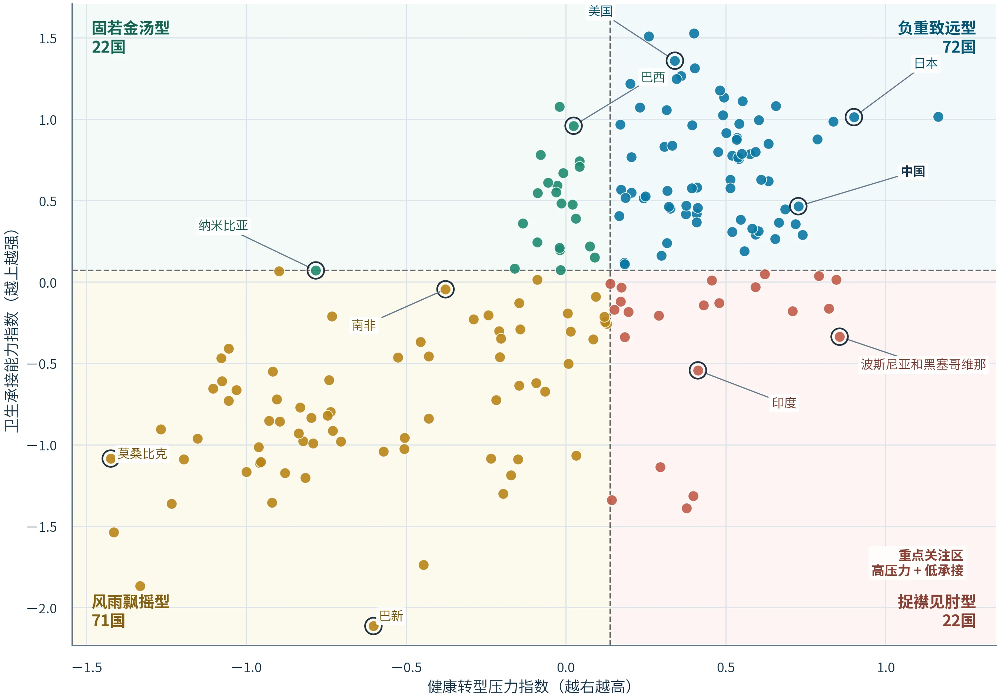
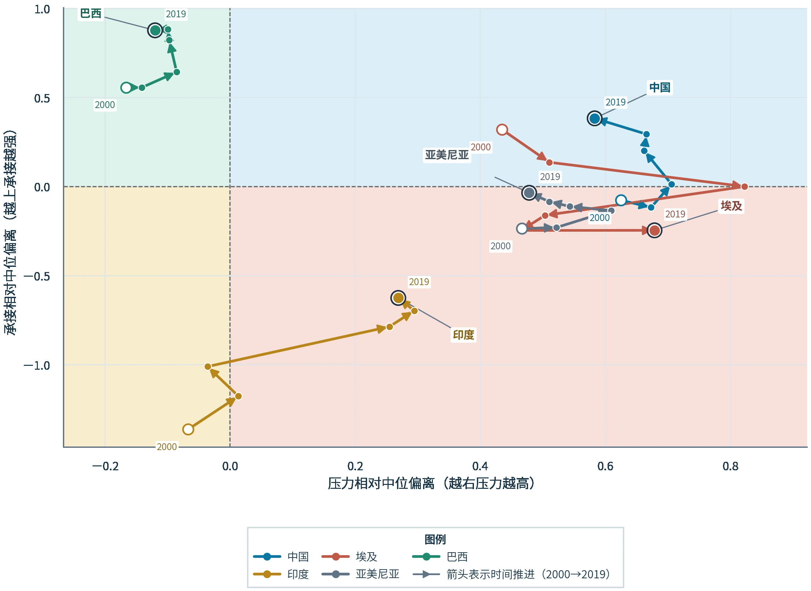
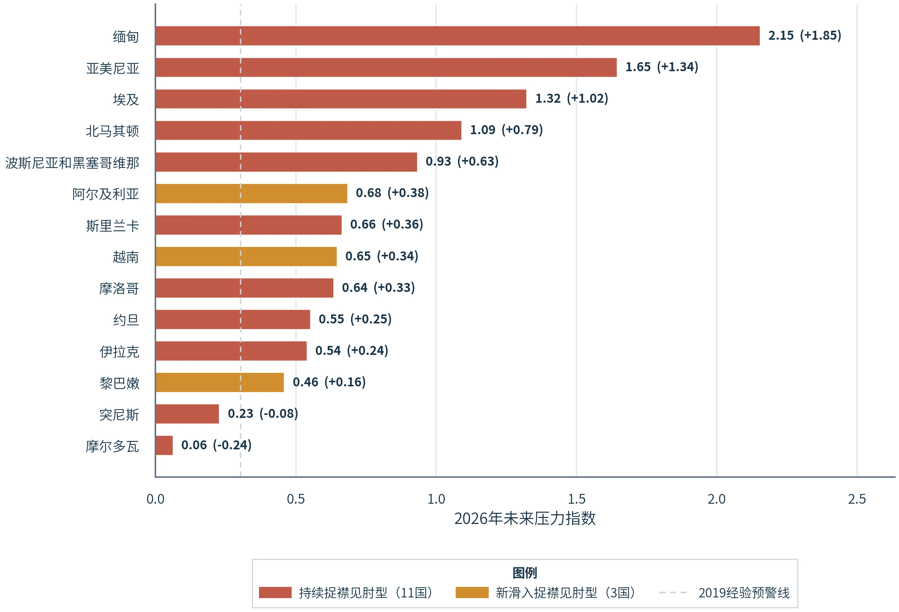
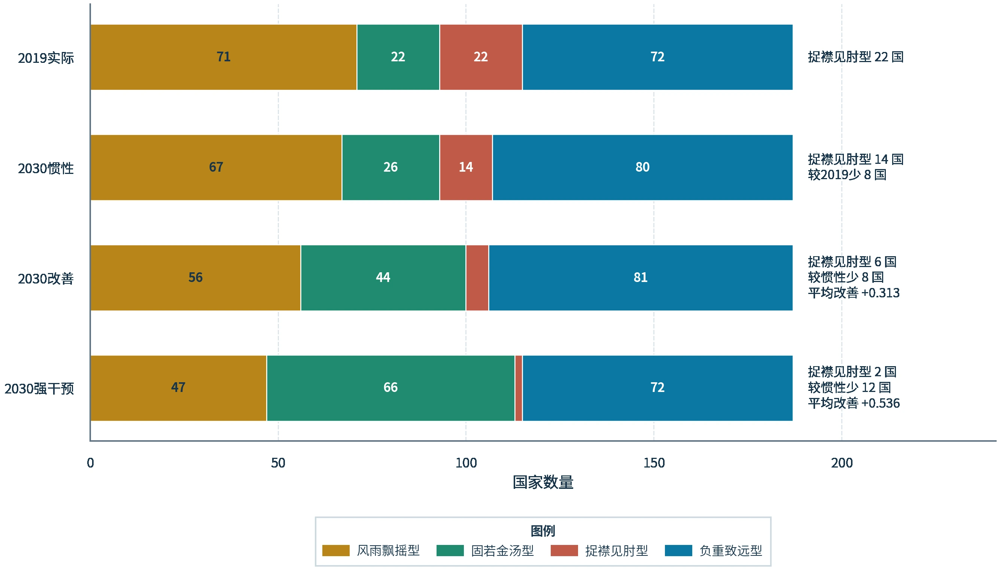

# 从治得上到治得起 — 全球健康转型中的慢病承接陷阱、国家分型与干预优先级研究

<p align="center">
  <b>From Treatable to Affordable: Chronic-Disease Absorption Traps, Country Typology &amp; Policy Scenario Modeling (2000–2030)</b>
</p>

<p align="center">
  
  
  
  <a href="https://www.heywhale.com/org/4C2026/competition/work-detail?work=69eaf383acdef02a88d7d9b0"></a>
  <a href="LICENSE"></a>
</p>

---

## 1. 核心数据图表总览 (Research Visual Gallery)

| 图 1 · 全球 203 个国家与地区四象限分型 | 图 2 · 典型发展中经济体跨期演化轨迹 |
| :---: | :---: |
|  |  |
| 基于「健康转型压力指数 × 卫生承接能力指数」划分固若金汤型、负重致远型、风雨飘摇型与捉襟见肘型四类国家 | 追踪中国、巴西、印度、埃及与亚美尼亚五国（2000→2019）在慢病负担上升期与卫生保障扩张期的跨期演进轨迹 |

| 图 3 · 2026 年慢病承接陷阱短期高危预警排序 | 图 4 · 2023–2030 年三类政策干预情景推演 |
| :---: | :---: |
|  |  |
| 识别持续滞留高危区间及未来三年新滑入承接赤字区间的经济体优先级序列 | 量化对比基线外推、单纯控费、基层慢性病管理扩容与综合财政风险保护情景下的承接缺口变化 |

---

## 2. 研究背景与方法框架 (Methodology)

本研究整合 **GBD（全球疾病负担）**、**WHO（世界卫生组织）** 与 **世界银行（WDI / HNP）** 2000–2023 年覆盖全球 **203 个国家与地区** 的宏观卫生面板数据，跳出单一病种视角，评估发展中经济体在人口老龄化与慢性非传染性疾病（NCDs）加速期面临的「医疗技术可及但家庭与制度难以长期负担」结构性矛盾：

1. **双维评价体系构建**：
   - **健康转型压力指数（Transition Pressure Index）**：综合慢病伤残调整生命年（DALYs）占比变化率、老龄化斜率、代谢/环境风险暴露（PM2.5、城镇化率等）；
   - **卫生承接能力指数（System Absorption Index）**：综合全民健康覆盖（UHC）服务可及性指数、政府卫生支出占 GDP 比重、自付医疗支出（OOP）反向保护度与基层卫生人力密度。
2. **四象限国家分型与演化追踪**：识别「固若金汤型（低压力-高承接）」「负重致远型（高压力-高承接）」「捉襟见肘型（低压力-低承接）」与「风雨飘摇型（高压力-低承接）」，刻画 24 年跨期跃迁路径。
3. **2026 短期预警与 2030 政策情景模拟**：构建面板外推与参数反事实实验，评估不同公共卫生投入与自付封顶干预对高危国家风险消减的边际收益。

---

## 3. 仓库结构 (Repository Structure)

```text
4c-health-insight-showcase/
├── assets/
│   ├── health_quadrant.webp         # 图 1：全球 203 个经济体四象限分型
│   ├── health_trajectories.webp     # 图 2：五国跨期演化轨迹（中/巴/印/埃/亚）
│   ├── health_warning.webp          # 图 3：2026 短期高危预警排序
│   └── health_scenarios.webp        # 图 4：2023–2030 政策情景推演
├── 分析代码/
│   └── 00_构建官方数据底座.py       # 官方基础数据集标准化清洗与宽表构建管线
├── 环境配置/
│   ├── conda-4c-health.yml          # Conda 可复现环境配置
│   └── .env.local.example           # 环境变量示例模板
├── 最终参赛方案.md                  # 完整研究设计、指标口径与政策推演文档
├── LICENSE                          # MIT 开源许可协议
└── README.md
```

---

## 4. 环境复现与数据底座构建 (Quick Start)

```bash
git clone https://github.com/Evan-Joseph/4c-health-insight-showcase.git
cd 4c-health-insight-showcase

conda env create -f 环境配置/conda-4c-health.yml
conda activate 4c-health

# 将官方赛事基础数据包放置于 比赛数据集/官方基础数据集_20260322.tar.gz 后执行：
python 分析代码/00_构建官方数据底座.py
```

清洗后的标准化面板文件输出至 `分析输出/官方数据底座/`。完整的作品报告与交互展示可访问 [和鲸（HeyWhale）官方公开作品页](https://www.heywhale.com/org/4C2026/competition/work-detail?work=69eaf383acdef02a88d7d9b0)。

---

## 5. 数据与合规说明 (Data & Scope Notice)

- 本公开仓库提供完整研究方案、可复现环境定义、官方数据底座构建脚本与核心结论图表；
- 原始竞赛大型压缩包、中间派生大表及推荐审阅扫描件不包含在仓库内。

## 6. 开源许可 (License)

本项目采用 [MIT License](LICENSE) 开源。
